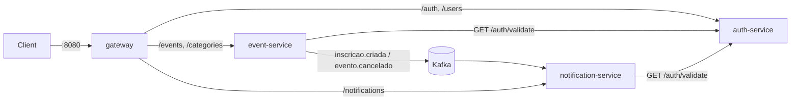

# Event Management

**Event management in microservices**: events, categories and public registrations, with JWT authentication and asynchronous notifications over Kafka.

---

## ✨ Flow



- **auth-service** issues the JWT (with the `uid`, `nome` and `roles` claims) and keeps the logout blacklist.
- The other services validate the signature locally and ask `auth-service` whether the token was revoked.
- **event-service** publishes to Kafka when someone registers or an event is cancelled; **notification-service** consumes and records the notifications (sending is simulated in the log).

---

## 🚀 How to use

### 1. Start everything (Kafka + apps)

```bash
docker compose up -d --build
```

Builds the 4 images (multi-stage `Dockerfile`, one per module via `SERVICE`) and starts `gateway` (8080), `auth-service` (8081), `event-service` (8082), `notification-service` (8083), plus **Kafka + Zookeeper** (9093 on the host).

### 2. Dev mode (apps on the host)

```bash
docker compose up -d kafka zookeeper
./mvnw -pl auth-service spring-boot:run          # :8081
./mvnw -pl event-service spring-boot:run         # :8082
./mvnw -pl notification-service spring-boot:run  # :8083
./mvnw -pl gateway spring-boot:run               # :8080
```

### 3. Test

```bash
TOKEN=$(curl -s -X POST localhost:8080/auth/login -H "Content-Type: application/json" \
  -d '{"email":"admin@email.com","senha":"123456"}' | jq -r .token)

curl -X POST localhost:8080/events -H "Authorization: Bearer $TOKEN" -H "Content-Type: application/json" \
  -d '{"titulo":"Meetup Java","dataHora":"2026-12-01T19:00:00","local":"SP","qtdVagas":50,"categoriaId":3}'

curl -X POST localhost:8080/events/1/inscrever -H "Content-Type: application/json" \
  -d '{"nome":"Maria","email":"maria@email.com"}'

curl "localhost:8080/notifications?email=maria@email.com" -H "Authorization: Bearer $TOKEN"
```

### 4. API docs (Swagger)

Each service exposes its own Swagger UI at `/swagger-ui.html` (e.g. http://localhost:8082/swagger-ui.html).

---

## 🧱 Architecture

Maven multi-module mono-repo:

| Module | Port | Role |
|--------|------|------|
| `common` | — | Shared code: `JwtSupport`, `JwtAuthenticationFilter`, `KafkaTopics`, messages, `GlobalExceptionHandler` |
| `auth-service` | 8081 | Users, roles, login/logout and JWT issuing (H2 `auth-db`) |
| `event-service` | 8082 | Events, categories and participants (H2 `event-db`), publishes to Kafka |
| `notification-service` | 8083 | Consumes Kafka and records notifications (H2 `notification-db`) |
| `gateway` | 8080 | Spring Cloud Gateway: single entry point for all routes |

### Kafka topics
| Topic | Role |
|-------|------|
| `events.inscricao.criada` | Registration confirmed (key = `eventoId`) |
| `events.evento.cancelado` | Event cancelled, with the e-mails of the registered participants |

Messages are sent at the end of the transaction. If you need a delivery guarantee on rollback, the next step is `@TransactionalEventListener(AFTER_COMMIT)` or an outbox.

### Observability
`/actuator/health`, `/actuator/metrics` and `/actuator/prometheus` on every service.

---

## Default Admin

| Email | Password |
|-------|----------|
| `admin@email.com` | `123456` |

`JWT_SECRET` must be the same in every service (the dev default is already the same).

## Endpoints

### Authentication — auth-service

| Method | Route | Description | Auth |
|--------|-------|-------------|------|
| POST | `/auth/register` | Register new user | ❌ |
| POST | `/auth/login` | Login (returns JWT) | ❌ |
| POST | `/auth/logout` | Invalidate token | ✅ |
| GET | `/auth/me` | Logged-in user profile | ✅ |
| GET | `/auth/validate` | 200 if the token is valid and not revoked (internal) | ✅ |
| GET | `/users` | List users (paginated) | ✅ ADMIN |
| PATCH | `/users/{id}/roles` | Set roles (`{"roles":["ROLE_USER","ROLE_ADMIN"]}`), takes effect on the next login | ✅ ADMIN |

### Events — event-service

| Method | Route | Description | Auth |
|--------|-------|-------------|------|
| GET | `/events` | List events (paginated + filters) | ❌ |
| GET | `/events/me` | Events created by the logged-in user | ✅ |
| GET | `/events/{id}` | Event detail | ❌ |
| POST | `/events` | Create event | ✅ USER |
| PUT | `/events/{id}` | Update event | ✅ |
| DELETE | `/events/{id}` | Delete event | ✅ |
| PATCH | `/events/{id}/status` | Change status (`CANCELLED` notifies the participants) | ✅ |

### Participants — event-service

| Method | Route | Description | Auth |
|--------|-------|-------------|------|
| POST | `/events/{id}/inscrever` | Public registration | ❌ |
| GET | `/events/{id}/participantes` | List registered participants | ✅ ADMIN |
| POST | `/events/{id}/participantes` | Register manually | ✅ ADMIN |
| DELETE | `/events/{id}/participantes/{id}` | Remove participant | ✅ ADMIN |

### Categories — event-service

| Method | Route | Description | Auth |
|--------|-------|-------------|------|
| GET | `/categories` | List categories | ❌ |
| GET | `/categories/{id}` | Detail | ❌ |
| GET | `/categories/{id}/events` | Events in the category (paginated) | ❌ |
| POST | `/categories` | Create | ✅ ADMIN |
| PUT | `/categories/{id}` | Update | ✅ ADMIN |
| DELETE | `/categories/{id}` | Delete | ✅ ADMIN |

### Notifications — notification-service

| Method | Route | Description | Auth |
|--------|-------|-------------|------|
| GET | `/notifications?email=` | Generated notifications (optional filter by recipient) | ✅ ADMIN |

## Filters (GET /events)

| Parameter | Type | Description |
|-----------|------|-------------|
| `categoriaId` | Long | Filter by category |
| `status` | EventStatus | `UPCOMING`, `ONGOING`, `FINISHED`, `CANCELLED` |
| `busca` | String | Search by title or description |
| `dataInicio` | LocalDateTime | Start date |
| `dataFim` | LocalDateTime | End date |

## Event Status

The status is calculated automatically based on `dataHora`:

- `dataHora > now` → **UPCOMING**
- `dataHora <= now < dataHora + 2h` → **ONGOING**
- `dataHora + 2h <= now` → **FINISHED**
- Manual PATCH → **CANCELLED**
